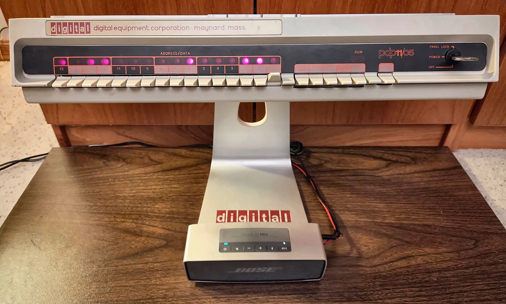

# PDP-11/05 Panel Reawakening

A multi-media art project bringing a PDP-11/05 front panel back to life.

## What it is

This is a genuine DEC PDP-11/05 front panel, given to me in working condition but with nothing to drive it. I gave it a new purpose as an interactive art piece. The panel and its electronics are mounted on a repurposed Apple Cinema Display stand, a grandchild supporting the grandparent.

An ESP32 now runs the panel. It is thousands of times faster than the original 11/05 and has more than 100 times the memory, yet the lights and toggles still do what a front panel should. Flip the switches, press the buttons, and see what happens.

## Modes

The three low switches select a mode, and toggling START activates it.

| Mode | What it does |
|------|--------------|
| 0 | Switch echo: switches light their matching LEDs |
| 1 | Binary clock with Westminster chime, temperature, and timer |
| 2 | Blinkenlights computer: classic computer light patterns with audio |
| 3 | Soundboard: sound effects from classic movies and TV |
| 4 | Knight Rider homage |
| 5 | SD card jukebox |
| 6 | Bluetooth audio receiver with VU meter displays |
| 7 | Settings: view and change flash-stored parameters |

At power on, the panel plays a verbal greeting. There may be other surprises. The user manual covers everything that is not a secret.

## Hardware

- **Panel:** original PDP-11/05 front panel
- **Interface board:** shift registers read the switches and drive the LEDs, with HCT logic bridging to the panel's legacy TTL levels
- **Control board:** ESP32, BT201 Bluetooth/MP3 sound card, DS3231 real-time clock, and audio conditioning for the VU meter input
- **Power:** 5 V, 2 A wall supply

Both boards are home-made, double-sided, and documented in the technical manual with schematics, layouts, and a bill of materials.

## Documentation

- [User Manual](docs/PDP-11-05_Panel_Reawakening-User_Manual.pdf): Operation guide.
- [Technical Manual](docs/PDP-11-05_Panel_Reawakening-Technical_Manual.pdf): Schematics, PCB layouts, BOM, assembly, and firmware overview.
- [Quick Reference](docs/PDP-11-05_Panel_Reawakening-Quick_Reference_Full_Page.pdf): One page guide
- [Quick Reference](docs/PDP-11-05_Panel_Reawakening-Quick_Reference_HalfPage_2up.pdf): Half page guide

## Firmware

The firmware is C++ for the ESP32, built around a cooperative task scheduler. Main components:

- **Task scheduler:** cooperative tasks, no RTOS juggling
- **Panel I/O:** switch scanning with debounce, and a display refresh task that writes the LEDs only when something changes
- **BT201 driver:** command/response protocol for the sound card, with a transmitter task, a receiver task, and a parent task
- **VU meter:** audio-reactive LED displays with several music and voice styles
- **BLE remote:** panel switches can be operated over Bluetooth Low Energy

### Building

1. Install [PlatformIO](https://platformio.org/) (VS Code extension or CLI).
2. Clone this repository and open the folder.
3. Connect the ESP32 and run `pio run -t upload`.

The BT201 needs its SD card loaded with the audio content. See the user manual for the folder and channel layout.

## Repository layout

| Folder | Contents |
|--------|----------|
| `docs/` | User manual, technical manual, quick reference |
| `layout/` | Interface and control board layouts |
| `lib/` | Project libraries (task scheduler, flash settings, disable comm) |
| `src/` | Main firmware source |
| `lib/` | Project libraries (task scheduler, BT201 driver, and others) |
| `media/` | Project photos |

## Status

The panel is complete and running. It is an entry in the 2026 Hackaday Retrocomputing Challenge (Old Iron category).

- Hackaday project page: [PDP-11/05 Panel Reawakening]
(https://hackaday.io/project/207170-pdp-1105-panel-reawakening)
- Full demo video: [YouTube](https://youtu.be/IMCUDBIAlJI)
- Condensed self-destruct sequence: [YouTube](https://youtu.be/9wBbOCsPhzk)

## About the key

The panel's key was missing when I got it, which turned into a small adventure of its own. The whole story, including how to get a working duplicate, is in Appendix III of the technical manual.

## License

See the `LICENSE` file.

## Acknowledgments

PDP-11 is a trademark of Digital Equipment Corporation (DEC). This project is an independent hobby work and is not affiliated with or endorsed by DEC or its successors.
